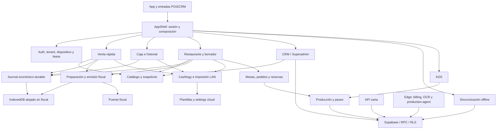

# Análisis de acoplamiento de Tickit POS

Fecha: 26 de octubre de 2026. Revisión local de `02b1972a28d82a14a916a6146ae9011695e5ddf5`. No se ha modificado código de producto, esquema, configuración ni datos de producción. Se añaden este informe y sus métricas. El build genera artefactos locales e intentó publicar metadatos/sourcemaps en Sentry; esas operaciones fallaron por DNS.

## 1. Diagnóstico

Tickit tiene una organización modular reconocible, pero la independencia de sus componentes es desigual. Catálogo, componentes UI y algunos modelos puros tienen fronteras claras. El núcleo de operación —venta, caja, fiscalidad, recuperación offline y Cashlogy— funciona como un agregado distribuido entre hooks, servicios, stores, almacenamiento del navegador y RPC SQL.

La principal deuda no consiste en numerosos ciclos de imports: sólo aparece un componente fuertemente conexo al excluir imports explícitamente de tipos. Consiste en **cuántas piezas deben cambiar juntas y respetar el mismo orden para completar una operación económica**. Hay mecanismos sólidos para conservar dinero e identidad después de respuestas perdidas. Parte del acoplamiento sostiene precisamente esas garantías; separarlo indiscriminadamente empeoraría el sistema.

Los puntos que merecen atención primero son:

1. **Defecto de cálculo reproducido:** restaurante admite cantidades decimales, pero ciertos caminos de cierre y construcción de documentos producen fracciones de céntimo que el validador monetario rechaza.
2. **Defecto de verificación reproducido:** el workflow de seguridad de migraciones ejecuta dos archivos de prueba inexistentes.
3. **Riesgos de consistencia:** cambios posteriores del pago tienen una persistencia menos atómica que la venta inicial; varias proyecciones de un ticket requieren precedencia y reconciliación manual.
4. **Dependencia de disponibilidad:** impresión LAN espera consultas cloud de plantillas sin un plazo propio de aplicación.
5. **Impacto transversal de cambios:** persistencia económica dentro del módulo fiscal, controladores de POS en la composición global, contratos SQL manuales y migraciones que parchean el texto de funciones previas.

No se ha demostrado fuga entre tenants, doble cobro, pérdida de dinero ni fallo de hardware real durante esta revisión. Los escenarios inferidos se distinguen de las reproducciones.

## 2. Alcance y método

### Evidencia recogida

- Inventario y grafo AST de todos los archivos `.ts`, `.tsx` y `.mts` de `src`, `apps/api/src` y `supabase/functions`, excluyendo `.d.ts`.
- Resolución de imports relativos, reexports, imports de tipos y `import()` con literal. Se distinguen 3 clases de arista.
- Dependencias entrantes/salientes por archivo y agrupación funcional; componentes fuertemente conexos mediante Tarjan.
- Lectura de composición, controladores, persistencia, contratos, servicios y pruebas de los flujos críticos. Revisión dirigida de SQL y workflows.
- Compilación local y lectura de los imports ESM del HTML generado, junto con los mapas de fuentes, para comprobar qué se carga antes de abrir una pantalla lazy.
- Ejecución de lint, suite completa JS/TS y pruebas Python de despliegue. Dos reproducciones mínimas independientes de la suite.

### Límites

El grafo es estático y sintáctico. «Ejecución» significa import no declarado explícitamente como tipo, más imports dinámicos donde se indica; no demuestra que cada símbolo se ejecute. Los reexports pueden sobreestimar dependencias que el bundler elimina. El grafo no descubre RPC calculadas, relaciones por nombres/eventos, llamadas HTTP, tablas SQL ni referencias de configuración: estas se revisaron separadamente en los caminos relevantes.

No se inspeccionaron exhaustivamente todas las definiciones históricas SQL, todos los estilos, ni todos los estados visuales. No se minó el historial de co-cambios de Git. No se ejecutó navegador real, iPad/PWA, hardware LAN, puente fiscal, Deno desplegado, Stripe ni producción. PGlite y fake-indexeddb ejercitan comportamientos importantes, pero no reproducen todos esos entornos. El análisis describe esta revisión local; no certifica la versión desplegada.

## 3. Métricas

Las líneas incluyen comentarios y líneas vacías, sin contar como línea adicional el segmento vacío después del último salto. Los recuentos no son una puntuación de calidad.

| Área medida | Archivos | Líneas |
|---|---:|---:|
| Frontend `src` | 444 | 67.715 |
| API Node | 3 | 229 |
| Edge Functions y módulos compartidos | 21 | 8.200 |
| **Total** | **468** | **76.144** |

| Relación | Cantidad |
|---|---:|
| Declaraciones de import/reexport resueltas | 1.943 |
| Imports/reexports estáticos no explícitamente de tipos | 1.437 |
| Imports/reexports de tipos | 466 |
| Imports dinámicos con literal | 40 |
| Componentes fuertemente conexos incluyendo tipos | 5 |
| Componentes fuertemente conexos excluyendo tipos | 1, de 2 archivos |
| Archivos que importan directamente `lib/supabase.ts` | 39 |

Las únicas referencias relativas fuera del universo TypeScript son `themes.json` e `index.css`; no son imports rotos.

### Concentración por archivo

Fan-out = archivos locales distintos de los que depende un archivo; fan-in = archivos locales distintos que lo importan. Incluyen tipos y dinámicos. La última columna excluye tipos y conserva dinámicos.

| Archivo | Líneas | Fan-in | Fan-out | Fan-out sin tipos |
|---|---:|---:|---:|---:|
| [src/app/PosPage.tsx](C:/Users/david/Desktop/CRAFO/chapuzalia/inmobiliaria/chapu/POS/src/app/PosPage.tsx) | 886 | 1 | 44 | 38 |
| [src/app/AppShell.tsx](C:/Users/david/Desktop/CRAFO/chapuzalia/inmobiliaria/chapu/POS/src/app/AppShell.tsx) | 596 | 1 | 37 | 34 |
| [src/features/restaurant/hooks/useRestaurantController.ts](C:/Users/david/Desktop/CRAFO/chapuzalia/inmobiliaria/chapu/POS/src/features/restaurant/hooks/useRestaurantController.ts) | 1.431 | 1 | 34 | 29 |
| [src/features/crm/routing/CrmSectionContent.tsx](C:/Users/david/Desktop/CRAFO/chapuzalia/inmobiliaria/chapu/POS/src/features/crm/routing/CrmSectionContent.tsx) | 174 | 1 | 34 | 31 |
| [src/features/cash-registers/hooks/useCashSession.ts](C:/Users/david/Desktop/CRAFO/chapuzalia/inmobiliaria/chapu/POS/src/features/cash-registers/hooks/useCashSession.ts) | 666 | 1 | 26 | 25 |
| [src/features/local-printing/index.ts](C:/Users/david/Desktop/CRAFO/chapuzalia/inmobiliaria/chapu/POS/src/features/local-printing/index.ts) | 30 | 8 | 26 | 25 |
| [src/services/posService.ts](C:/Users/david/Desktop/CRAFO/chapuzalia/inmobiliaria/chapu/POS/src/services/posService.ts) | 1.318 | 10 | 12 | 10 |
| [src/lib/offlineStore.ts](C:/Users/david/Desktop/CRAFO/chapuzalia/inmobiliaria/chapu/POS/src/lib/offlineStore.ts) | 270 | 15 | 7 | 4 |
| [src/features/fiscal/local/localLedger.ts](C:/Users/david/Desktop/CRAFO/chapuzalia/inmobiliaria/chapu/POS/src/features/fiscal/local/localLedger.ts) | 760 | 13 | 6 | 4 |

Un router con mucho fan-out puede estar cumpliendo bien su función. Un servicio con menos imports puede esconder cientos de dependencias por RPC, tablas y mensajes. Por eso `posService` importa más por su amplitud funcional que por su fan-out.

### Dependencias compartidas

| Módulo | Consumidores directos | Interpretación |
|---|---:|---|
| `types/index.ts` | 167 | Sólo tipos; contrato amplio de compilación, sin coste runtime de estos imports |
| `components/ui/Button.tsx` | 67 | Reutilización deseable de UI |
| `lib/format.ts` | 64 | Formato mezclado con cantidades, firmas y cálculo de líneas: cambios monetarios necesitan especial cuidado |
| `components/ui/index.ts` | 53 | Fachada útil; revisar efectos sobre agrupación/carga |
| `catalog/domain/types.ts` | 44 | Contrato compartido entre edición y venta |
| `utils/errors.ts` | 42 | Normalización transversal deseable |
| `local-printing/types.ts` | 41 | Sólo tipos; contrato de hardware ampliamente compartido |
| `lib/supabase.ts` | 39 | Infraestructura y ciclo de vida compartidos |

### Acoplamiento por agrupación

Ca = grupos externos que consumen el grupo; Ce = grupos externos consumidos. Se agrupa CRM por subdominio, componentes por subcarpeta y el resto de features por feature. No son paquetes independientes y estos números dependen de esa partición. Incluyen tipos, estáticos y dinámicos.

| Grupo | Archivos | Ca | Ce | Evaluación |
|---|---:|---:|---:|---|
| App/composición | 7 | 5 | 29 | Esperable en composición; excesivo alcance del ciclo de vida POS |
| Restaurante | 14 | 4 | 12 | Alto; coordina borrador, producción, cobro, fiscal e impresión |
| Mesas | 32 | 7 | 12 | Alto; mezcla mapa, pedidos, reservas, producción y documentos |
| Caja | 14 | 6 | 10 | Alto; agregado económico y adaptadores hardware/fiscales |
| Impresión/Cashlogy | 56 | 10 | 9 | Alto; dos responsabilidades con flujos de riesgo muy distintos |
| Venta rápida | 10 | 4 | 8 | Alto en checkout; edición de líneas más aislada |
| Sesión | 6 | 3 | 7 | Alto por protocolo de hidratación y dependencias de app |
| Fiscal | 29 | 8 | 6 | Alto impacto; almacén local también soporta economía general |
| Catálogo | 20 | 14 | 3 | Buena frontera relativa; predominan contratos de tipos |
| Reservas | 15 | 2 | 5 | Medio; dependencia bidireccional con mesas a nivel de feature |
| Producción/KDS | 8 | 3 | 8 | Medio/alto; fuerte contrato SQL y Realtime |
| UI compartida | 15 | 35 | 0 | Buena dirección de dependencias internas |
| Tipos compartidos | 3 | 43 | 0 | Contrato transversal amplio, sin aristas de ejecución salientes |

`features/offline` contiene sólo 7 archivos: no representa por sí sola el subsistema offline. Mucha implementación vive en `hooks/useOfflineSync`, `lib/offlineStore`, `lib/durableSales`, fiscal y caja. La estructura de carpetas infrarrepresenta el alcance real.

## 4. Mapa funcional

Las flechas indican consumo/coordinación principal. No son un grafo completo ni representan necesariamente un import directo.



### Dependencias de negocio que conviene preservar

- Una venta confirmada debe conservar importes, identidad de pago, caja, usuario, dispositivo, snapshots y estado fiscal.
- Reservar el checkout de restaurante antes de pedir dinero al hardware protege el mismo pedido frente a otros terminales.
- El registro fiscal pendiente no debe adelantarse a la confirmación de la venta económica correspondiente.
- Un fallo de impresión o de estadísticas después del commit no debe hacer que el usuario vuelva a cobrar.
- Las revisiones de pedido, cantidades enviadas/servidas y estado KDS forman invariantes comunes.

Reducir imports no equivale a mejorar esos contratos. La unidad correcta de cambio es el flujo observable y su recuperación.

## 5. Hallazgos priorizados

**Alta**: afecta dinero, continuidad de operación o controles que protegen cambios críticos. **Media**: eleva propagación, complejidad o riesgo de regresión. **Baja**: limpieza de frontera de alcance limitado. La prioridad arquitectónica no implica que exista un incidente en producción.

### H01 — Alta · Cálculo monetario duplicado e incompatible con cantidades decimales

**Estado: reproducción local del cálculo y camino soportado confirmados; sin reproducción UI/DB completa.**

El editor permite tres decimales ([src/features/tables/components/RestaurantOrderPanel.tsx:672](C:/Users/david/Desktop/CRAFO/chapuzalia/inmobiliaria/chapu/POS/src/features/tables/components/RestaurantOrderPanel.tsx:672)), el controlador valida cantidades positivas con precisión de milésimas ([src/features/restaurant/hooks/useRestaurantController.ts:1203](C:/Users/david/Desktop/CRAFO/chapuzalia/inmobiliaria/chapu/POS/src/features/restaurant/hooks/useRestaurantController.ts:1203)) y SQL usa `numeric(18,3)` ([supabase/migrations/20260916130100_decimal_order_production_quantities.sql:11](C:/Users/david/Desktop/CRAFO/chapuzalia/inmobiliaria/chapu/POS/supabase/migrations/20260916130100_decimal_order_production_quantities.sql:11)). El borrador redondea mediante `quantityAmountCents` ([src/features/restaurant/hooks/useRestaurantDraft.ts:42](C:/Users/david/Desktop/CRAFO/chapuzalia/inmobiliaria/chapu/POS/src/features/restaurant/hooks/useRestaurantDraft.ts:42)).

Sin embargo, el cierre entrega `unitPriceCents * quantity` al cálculo de descuentos ([src/features/restaurant/hooks/useRestaurantController.ts:935](C:/Users/david/Desktop/CRAFO/chapuzalia/inmobiliaria/chapu/POS/src/features/restaurant/hooks/useRestaurantController.ts:935)), que exige enteros ([src/lib/discounts.ts:215](C:/Users/david/Desktop/CRAFO/chapuzalia/inmobiliaria/chapu/POS/src/lib/discounts.ts:215)). También hay productos directos en [src/features/restaurant/services/restaurantPrintPayload.ts:56](C:/Users/david/Desktop/CRAFO/chapuzalia/inmobiliaria/chapu/POS/src/features/restaurant/services/restaurantPrintPayload.ts:56), `:141` y `:169`.

Reproducción ejecutada con los helpers reales:

```text
199 céntimos × 1,5 = 298,5
calculateDiscountForLines(... grossCents: 298.5 ...) -> error
quantityAmountCents(199, 1.5) -> 299
```

El defecto observable en el cálculo es consecuencia de mantener varias interpretaciones de «total de línea». La corrección debe establecer una regla canónica y probar borrador → guardado → cobro total/parcial → split → documento → fiscal, conservando el criterio de redondeo del servidor. No basta con silenciar la validación ni redondear sólo la presentación.

### H02 — Alta · CI referencia suites que ya no existen

**Estado: fallo reproducido.**

`src` puede compilar y todas las pruebas actuales pasar, mientras el workflow falla por un contrato de rutas roto. [.github/workflows/migration-safety.yml:85](C:/Users/david/Desktop/CRAFO/chapuzalia/inmobiliaria/chapu/POS/.github/workflows/migration-safety.yml:85) ejecuta:

```text
node --test tests/migration-safety.test.mjs tests/migration-safety-exception.test.mjs
```

Ninguno de esos archivos existe en esta revisión. Ejecutar el paso termina con código 1 y «Could not find …». El workflow está acoplado a nombres de archivos fuera del comando agregado de pruebas; la poda de tests no actualizó ese consumidor.

Debe recuperarse la cobertura conductual del checker o apuntar el workflow a sus sucesores reales. Eliminar el paso sin reemplazo reduciría la protección de migraciones. No se ha editado el workflow en este análisis.

### H03 — Alta · Mutaciones posteriores al cobro con durabilidad distinta

**Estado: riesgo sustentado por secuencia de escrituras; fallo no inyectado.**

La venta inicial agrupa operación, snapshot y evento en una transacción IndexedDB ([src/lib/durableSales.ts:229](C:/Users/david/Desktop/CRAFO/chapuzalia/inmobiliaria/chapu/POS/src/lib/durableSales.ts:229)). El cambio de método de pago escribe tickets, ledger y evento pendiente mediante operaciones separadas ([src/features/cash-registers/hooks/useCashTicketActions.ts:207](C:/Users/david/Desktop/CRAFO/chapuzalia/inmobiliaria/chapu/POS/src/features/cash-registers/hooks/useCashTicketActions.ts:207)). `writeJson` puede lanzar ([src/lib/offlineStore.ts:75](C:/Users/david/Desktop/CRAFO/chapuzalia/inmobiliaria/chapu/POS/src/lib/offlineStore.ts:75)).

Una excepción entre escrituras puede dejar proyecciones desalineadas o una mutación sin su evento. El journal de Cashlogy añade evidencia que debe reconciliarse si ya intervino hardware. Esto no demuestra que haya ocurrido pérdida de dinero.

Conviene definir un commit durable para la mutación económica y derivar de él las proyecciones. Primero debe probarse un fallo en cada escritura y la recuperación tras recarga, manteniendo payloads instalados y relación con el evento original de venta.

### H04 — Alta · Impresión LAN depende de consultas cloud antes de enviar el trabajo

**Estado: dependencia demostrada; demora real no medida.**

[src/features/local-printing/services/printCompletedSale.ts:18](C:/Users/david/Desktop/CRAFO/chapuzalia/inmobiliaria/chapu/POS/src/features/local-printing/services/printCompletedSale.ts:18) espera la impresora seleccionada, la plantilla y el setting de QR antes de llamar al agente. [src/features/print-templates/service.ts:15](C:/Users/david/Desktop/CRAFO/chapuzalia/inmobiliaria/chapu/POS/src/features/print-templates/service.ts:15) consulta plantilla personalizada y, cuando procede, plantilla predeterminada en BD, secuencialmente.

Existe fallback seguro, pero sólo después de que esas promesas resuelvan o fallen. No hay caché ni plazo propio para esas consultas. [src/lib/backendFetch.ts:13](C:/Users/david/Desktop/CRAFO/chapuzalia/inmobiliaria/chapu/POS/src/lib/backendFetch.ts:13) limita auth; no esas peticiones REST. El acceso fiscal sí tiene lecturas acotadas ([src/features/fiscal/local/backendRead.ts:7](C:/Users/david/Desktop/CRAFO/chapuzalia/inmobiliaria/chapu/POS/src/features/fiscal/local/backendRead.ts:7)).

Aunque la impresora y el agente estén disponibles en la LAN, una conexión cloud lenta puede demorar el envío del documento. Una mejora debe llevar una plantilla validada/cacheada al flujo de impresión y limitar la preparación remota, manteniendo contenido fiscal, copias e idempotencia. Hace falta una prueba donde REST no resuelva y el agente sí responda.

### H05 — Alta · El almacén económico general pertenece al módulo fiscal

**Estado: inversión de dependencias y esquema compartido demostrados; no ciclo runtime.**

[src/lib/durableSales.ts:1](C:/Users/david/Desktop/CRAFO/chapuzalia/inmobiliaria/chapu/POS/src/lib/durableSales.ts:1) consume `openLedger` desde fiscal. [src/features/fiscal/local/localLedger.ts:28](C:/Users/david/Desktop/CRAFO/chapuzalia/inmobiliaria/chapu/POS/src/features/fiscal/local/localLedger.ts:28) posee la BD `tickit-verifactu-local-v1`, versión 5, y crea tanto registros fiscales como `paymentOperations`, `durableSales`, `durableEvents` y `restaurantPayments` (`:71`). El journal también conoce la cancelación de reservas de restaurante mediante import dinámico ([src/lib/durableSales.ts:161](C:/Users/david/Desktop/CRAFO/chapuzalia/inmobiliaria/chapu/POS/src/lib/durableSales.ts:161)).

Compartir una transacción es una fortaleza. La propiedad del mecanismo está mal delimitada: una evolución del esquema fiscal alcanza cobros generales y sincronización offline. Extraer apertura/versionado y primitivas a infraestructura neutral reduciría esa dependencia conservando nombre, versión, stores, índices y transacciones. Separar físicamente las bases de datos sin sustituir su atomicidad sería peligroso.

### H06 — Alta · Composición global con controladores de todas las aplicaciones

**Estado: estructura y presencia en bundle verificadas.**

[src/App.tsx](C:/Users/david/Desktop/CRAFO/chapuzalia/inmobiliaria/chapu/POS/src/App.tsx) cumple su función pequeña. [src/app/AppShell.tsx:204](C:/Users/david/Desktop/CRAFO/chapuzalia/inmobiliaria/chapu/POS/src/app/AppShell.tsx:204) instancia caja, venta rápida, restaurante y reservas antes de seleccionar Superadmin, CRM, KDS o POS (`:517`). Las pantallas son lazy (`:67`), pero sus controladores y numerosos adaptadores forman parte del arranque común.

Además, [src/app/PosPage.tsx:72](C:/Users/david/Desktop/CRAFO/chapuzalia/inmobiliaria/chapu/POS/src/app/PosPage.tsx:72) recibe retornos completos de cuatro hooks mediante `ReturnType`. El contrato de props tiene 33 campos y la vista también conoce hardware, pendientes durables, descuentos, fiscalidad y configuración. Cambiar un controlador puede afectar composición, vista, bloqueo de updates, hidratación y recuperación.

La frontera útil sería un runtime POS que posea sus controladores y un shell común de sesión/rutas, junto con interfaces de vista acotadas por flujo. No se recomienda un Context global que oculte las mismas dependencias. Los guardas actuales evitan trabajo según contexto: no se afirma que cada hook consulte datos indebidamente en cada ruta.

### H07 — Alta · Evolución SQL dependiente del texto de funciones anteriores

**Estado: patrón demostrado; no fallo actual de migración completa reproducido.**

La búsqueda de `pg_get_functiondef`, sustituciones de `patched` y `execute patched` devuelve 62 coincidencias en siete migraciones. La migración [supabase/migrations/20261024123435_flexible_restaurant_menu_courses.sql:16](C:/Users/david/Desktop/CRAFO/chapuzalia/inmobiliaria/chapu/POS/supabase/migrations/20261024123435_flexible_restaurant_menu_courses.sql:16) obtiene definiciones previas y reemplaza fragmentos para alterar catálogo, guardado, producción, splits y servicio.

Los guards que abortan si falta una firma son valiosos: impiden cambios parciales silenciosos. Aun así, el resultado depende de la definición efectiva previa, del orden y de fragmentos textuales. Las pruebas de menús cargan fixtures seleccionados y normalizan saltos de línea; esto evidencia sensibilidad al texto, no un problema de datos de producción.

Debe añadirse confianza mediante replay desde los baselines compatibles y verificación del comportamiento de las funciones finales. En migraciones nuevas, helpers estables pueden reducir el parcheo textual. Las migraciones desplegadas deben seguir siendo inmutables y N-1; este informe no propone reescribirlas.

### H08 — Media/alta · API carta y POS comparten datos pero tienen validadores de línea distintos

**Estado: duplicación semántica demostrada; divergencia funcional no certificada.**

[supabase/migrations/20261017234914_tickit_carta_api.sql:159](C:/Users/david/Desktop/CRAFO/chapuzalia/inmobiliaria/chapu/POS/supabase/migrations/20261017234914_tickit_carta_api.sql:159) define `tickit_private.resolve_line`, con límites, selecciones y precios propios. Reutiliza algunos helpers canónicos, pero conserva lógica de componentes y suplementos. El cambio de menús flexibles modifica `save_catalog_order_lines_canonical` en otra migración sin convertir ambos caminos en un único contrato.

La diferencia puede ser legítima: una carta envía una elección completa y el POS mantiene borradores incompletos. El riesgo es evolucionar sólo uno al cambiar catálogo, disponibilidad, cantidades o precios. Conviene compartir invariantes y probar una matriz de equivalencia/diferencias admitidas entre API, POS y SQL, incluyendo replay idempotente.

### H09 — Media/alta · RPC y errores SQL son contratos manuales poco visibles para TypeScript

**Estado: contrato no tipado de extremo a extremo demostrado.**

[src/lib/supabase.ts:49](C:/Users/david/Desktop/CRAFO/chapuzalia/inmobiliaria/chapu/POS/src/lib/supabase.ts:49) declara un `SupabaseClient` sin un contrato `Database` generado. Los tipos de filas propios son parciales. El catálogo mejora la frontera mediante mapper y validación; otros servicios aceptan `Record<string, unknown>` y casts.

En [apps/api/src/app.ts:7](C:/Users/david/Desktop/CRAFO/chapuzalia/inmobiliaria/chapu/POS/apps/api/src/app.ts:7), `Database.rpc` admite nombre arbitrario, parámetros genéricos y respuesta `unknown`. Sus entradas HTTP sí usan Zod. En `:64`, la traducción HTTP depende de mensajes como `SESSION_UNAVAILABLE`, `IDEMPOTENCY_CONFLICT` y `CATALOG_`.

El inventario sintáctico frontend detecta 139 sitios RPC con 136 literales distintos, en 37 archivos; 145 usos `.from` con 58 literales en 28 archivos; y 20 invocaciones Edge con cinco destinos. Son candidatos sintácticos, no una certificación de llamadas ejecutadas; excluyen nombres calculados y relaciones implícitas.

Cambiar firma o JSON SQL no garantiza fallo de compilación. La mejora prioritaria es tipar/validar las fronteras críticas y estabilizar códigos de error, antes de extender wrappers indiscriminadamente. Se necesita cobertura real de los contratos API/SQL; las búsquedas dirigidas no localizaron tests de `createApp(` o `tickit_api_submit`.

### H10 — Media/alta · Bloqueo de actualización depende de informar manualmente de operaciones activas

**Estado: omisión estática concreta; sin recarga UI reproducida.**

[src/app/AppShell.tsx:480](C:/Users/david/Desktop/CRAFO/chapuzalia/inmobiliaria/chapu/POS/src/app/AppShell.tsx:480) calcula `updateBlocked` con estados de varios controladores y `auxiliaryOperationBusy`. CRM informa busy al shell ([src/components/crm/CrmPage.tsx:42](C:/Users/david/Desktop/CRAFO/chapuzalia/inmobiliaria/chapu/POS/src/components/crm/CrmPage.tsx:42)); otras áreas también reciben callback.

Superadmin mantiene un `isBusy`/`runAction` local ([src/components/superadmin/SuperAdminPage.tsx:87](C:/Users/david/Desktop/CRAFO/chapuzalia/inmobiliaria/chapu/POS/src/components/superadmin/SuperAdminPage.tsx:87), `:111`) y sus props no comunican ese estado. [src/app/AppShell.tsx:517](C:/Users/david/Desktop/CRAFO/chapuzalia/inmobiliaria/chapu/POS/src/app/AppShell.tsx:517) tampoco lo recibe. El banner ofrece recarga cuando `blocked` es falso ([src/components/feedback/AppUpdateBanner.tsx:18](C:/Users/david/Desktop/CRAFO/chapuzalia/inmobiliaria/chapu/POS/src/components/feedback/AppUpdateBanner.tsx:18)).

Hay un protocolo incompleto entre aplicaciones. No se ha demostrado pérdida de datos al recargar. Una prueba de actualización durante una mutación de cada aplicación debe preceder a ampliar el protocolo de operaciones activas.

### H11 — Media · Sesión como protocolo amplio de hidratación, limpieza y restauración

[src/features/session/hooks/useTenantSession.ts:19](C:/Users/david/Desktop/CRAFO/chapuzalia/inmobiliaria/chapu/POS/src/features/session/hooks/useTenantSession.ts:19) tiene 16 opciones que incluyen carga, aplicación online/offline, sincronización, limpieza y setters. [src/app/AppShell.tsx:331](C:/Users/david/Desktop/CRAFO/chapuzalia/inmobiliaria/chapu/POS/src/app/AppShell.tsx:331), `:362` y `:401` mantienen recorridos distintos para limpiar, hidratar online e hidratar offline.

Añadir estado persistido exige revisar los tres caminos, el cargador y la caché. El genérico `TenantState` no elimina ese acoplamiento de protocolo. Es recomendable un resultado de hidratación y reglas de reset por dueño de estado, con pruebas de cambio de tenant/dispositivo y restauración tardía. Las versiones de restauración y `isCurrent` existentes protegen frente a resucitar una sesión cerrada y deben conservarse.

### H12 — Media · Ruta, auth y almacenamiento tienen inicialización coordinada

[src/lib/supabase.ts:8](C:/Users/david/Desktop/CRAFO/chapuzalia/inmobiliaria/chapu/POS/src/lib/supabase.ts:8) captura `initialAppRoute` al evaluar el módulo y usa una clave auth de esa ruta. [src/app/AppRouter.tsx:25](C:/Users/david/Desktop/CRAFO/chapuzalia/inmobiliaria/chapu/POS/src/app/AppRouter.tsx:25) mueve sesión y usa navegación completa. [src/lib/offlineStore.ts:96](C:/Users/david/Desktop/CRAFO/chapuzalia/inmobiliaria/chapu/POS/src/lib/offlineStore.ts:96) clasifica caché por ruta/rol y conserva migración legacy.

Es un contrato deliberado de aislamiento. Convertir la navegación en SPA, renombrar `/crm` o añadir una aplicación requiere cambiar conjuntamente resolución de ruta, cliente auth, token, cache, entradas HTML, manifest y service worker. No es un cambio de router aislado.

Además, owner/manager → CRM aparece en política de app, almacenamiento y restauración/servicios. Las variantes revisadas son coherentes; el riesgo es mantenimiento duplicado al añadir roles. No se ha demostrado un bypass de autorización.

### H13 — Media · Varias fuentes del ticket y reconciliación de proyecciones

Tickets React, localStorage, ventas durables, snapshots fiscales y backend mantienen partes de la misma historia. [src/features/cash-registers/services/localSessionTickets.ts:8](C:/Users/david/Desktop/CRAFO/chapuzalia/inmobiliaria/chapu/POS/src/features/cash-registers/services/localSessionTickets.ts:8) combina fuentes, y su comentario en `:26` explica por qué la caché conserva cambios posteriores del pago, devolución e impresión.

Esto permite recuperar operaciones, pero el orden de combinación es un contrato de dominio. Deben documentarse por separado: economía original, mutaciones posteriores, estado de sincronización y estado de impresión. Ninguna de estas fuentes debe tratarse como una caché libremente eliminable.

Hay una carrera candidata: [src/features/cash-registers/hooks/useCashSession.ts:283](C:/Users/david/Desktop/CRAFO/chapuzalia/inmobiliaria/chapu/POS/src/features/cash-registers/hooks/useCashSession.ts:283) reemplaza ledger con un refresco remoto, mientras venta rápida añade una venta local después del commit ([src/features/quick-sale/hooks/useQuickSalePayment.ts:216](C:/Users/david/Desktop/CRAFO/chapuzalia/inmobiliaria/chapu/POS/src/features/quick-sale/hooks/useQuickSalePayment.ts:216)). Restaurante inicia ese refresco en segundo plano. La generación protege unos refrescos frente a otros, pero no registra cada nueva venta local. Una respuesta antigua puede ocultar temporalmente una venta aún no sincronizada. No se ha reproducido; el journal conserva la transacción. Debe probarse la intercalación antes de cambiar la reconciliación.

### H14 — Media · Offline combina ámbitos y secuencias de distinta granularidad

La cola legacy usa `clubpos:v1:queue`; la durable filtra por ruta. Tickets/ledger legacy se identifican con tenant/dispositivo y el journal de pago añade local, usuario y sesión ([src/lib/offlineStore.ts:122](C:/Users/david/Desktop/CRAFO/chapuzalia/inmobiliaria/chapu/POS/src/lib/offlineStore.ts:122), [src/lib/durableSales.ts:23](C:/Users/david/Desktop/CRAFO/chapuzalia/inmobiliaria/chapu/POS/src/lib/durableSales.ts:23)). El cierre bloquea ante pendientes del tenant ([src/features/cash-registers/hooks/useCashSession.ts:498](C:/Users/david/Desktop/CRAFO/chapuzalia/inmobiliaria/chapu/POS/src/features/cash-registers/hooks/useCashSession.ts:498)), una decisión conservadora que puede vincular su disponibilidad a otros ámbitos del dispositivo.

[src/hooks/useOfflineSync.ts:45](C:/Users/david/Desktop/CRAFO/chapuzalia/inmobiliaria/chapu/POS/src/hooks/useOfflineSync.ts:45) procesa en orden temporal y continúa tras errores. Eso ayuda a no bloquear todo por un evento, pero no garantiza dependencias por agregado después de un fallo antecedente. Los contratos SQL/idempotencia y el encadenado explícito al cambiar pago sostienen la corrección.

La mejora exige clasificar eventos dependientes, reintentables y terminales sin cambiar payloads instalados. Deben mantenerse identidad, orden relevante y errores visibles. No se ha detectado mezcla de datos entre tenants por estas claves.

### H15 — Media · Restaurante, KDS y mesas forman un agregado operativo fuerte

[src/features/restaurant/hooks/useRestaurantController.ts:1251](C:/Users/david/Desktop/CRAFO/chapuzalia/inmobiliaria/chapu/POS/src/features/restaurant/hooks/useRestaurantController.ts:1251) hace flush antes de enviar/servir. Editar/eliminar considera cantidades ya enviadas o servidas y genera efectos sobre producción. El pago añade reserva de checkout, revisión y sesión de caja.

Es acoplamiento de negocio necesario. Lo accidental es que un controlador de 1.431 líneas coordina muchas variantes y que «mesas» contiene servicios de pedidos, layout, reservas y producción. Dividir por casos de uso —editar comanda, despachar producción, cobrar y recuperar— resulta más útil que separar por tipo de archivo.

El borrador está en memoria, requiere conexión para guardar, hace autosave de 800 ms y recarga remoto ante conflicto ([src/features/restaurant/hooks/useRestaurantDraft.ts:50](C:/Users/david/Desktop/CRAFO/chapuzalia/inmobiliaria/chapu/POS/src/features/restaurant/hooks/useRestaurantDraft.ts:50), `:89`, `:115`). Su promesa offline es distinta de venta rápida. No debe presentarse toda la app como si cada operación tuviera la misma autonomía offline.

### H16 — Media · Realtime y polling generan amplificación entre dominios

[src/features/production/service.ts:165](C:/Users/david/Desktop/CRAFO/chapuzalia/inmobiliaria/chapu/POS/src/features/production/service.ts:165) escucha varias tablas por venue para una comanda; KDS escucha cambios de pedidos/líneas/asignaciones (`:205`). Hay polling de recuperación y restaurante conserva borradores sucios al refrescar.

Los mecanismos favorecen reconexión y PWA suspendida. Con muchos pedidos/terminales, eventos ajenos pueden provocar recargas amplias. KDS ya agrupa/debouncea lecturas ([src/features/production/useKdsQueue.ts:23](C:/Users/david/Desktop/CRAFO/chapuzalia/inmobiliaria/chapu/POS/src/features/production/useKdsQueue.ts:23)); restaurante coalesce cargas y hace una pasada final si entró otro evento ([src/features/restaurant/hooks/useRestaurantRealtime.ts:52](C:/Users/david/Desktop/CRAFO/chapuzalia/inmobiliaria/chapu/POS/src/features/restaurant/hooks/useRestaurantRealtime.ts:52)).

No se midió carga real. Antes de restringir filtros, conviene medir eventos → lecturas RPC y asegurar que no se omiten altas, eliminaciones o cambios indirectos. La recuperación por polling no debe retirarse sólo para reducir peticiones.

### H17 — Media · Catálogo CRM y proyección POS invalidan a través de composición

El catálogo tiene una buena frontera: dominio, mapper, repositorio con cliente inyectado, comandos e invalidación. El modelo de catálogo sólo depende de contratos y utilidades de bajo nivel.

Sin embargo, una mutación CRM refresca catálogo admin y proyección POS ([src/components/crm/CrmPage.tsx:64](C:/Users/david/Desktop/CRAFO/chapuzalia/inmobiliaria/chapu/POS/src/components/crm/CrmPage.tsx:64)), mediante callback conectado a `refreshCatalog` en [src/app/AppShell.tsx:523](C:/Users/david/Desktop/CRAFO/chapuzalia/inmobiliaria/chapu/POS/src/app/AppShell.tsx:523). Realtime enumera numerosas tablas y callbacks actualizan también cache/hidratación.

Cambiar un dato que integra el catálogo obliga a revisar comando, mapper, invalidación, lista Realtime y cache offline. La invalidación debería ser propiedad del módulo catálogo y sus proyecciones, manteniendo las diferencias admin/POS y snapshots históricos. No se ha demostrado un fallo de aislamiento por usar `venueId` en la caché; el repositorio valida ámbitos y las pruebas rechazan respuestas cross-venue.

### H18 — Media · Reservas y mesas tienen dependencias en ambos sentidos

Reservas consume servicio y geometría de mesas; mesas consume disponibilidad de reservas y su badge. Ejemplos: [src/features/reservations/hooks/useReservationsController.ts:5](C:/Users/david/Desktop/CRAFO/chapuzalia/inmobiliaria/chapu/POS/src/features/reservations/hooks/useReservationsController.ts:5), [src/features/tables/service.ts:17](C:/Users/david/Desktop/CRAFO/chapuzalia/inmobiliaria/chapu/POS/src/features/tables/service.ts:17) y [src/features/tables/components/TableMapView.tsx:73](C:/Users/david/Desktop/CRAFO/chapuzalia/inmobiliaria/chapu/POS/src/features/tables/components/TableMapView.tsx:73).

Hay además un ciclo exclusivamente de tipos entre `reservations/types.ts` y `tables/types.ts`. No hay SCC de ejecución entre esos archivos. La integración de disponibilidad es legítima; separar tipos/geométrica estable de modelos de presentación facilitaría reutilización sin arrastrar el otro subdominio completo. Se recomienda hacerlo cuando se evolucione el mapa o la asignación, sin inventar un framework genérico.

### H19 — Media · Contratos hardware manuales y validación desigual

[src/features/local-printing/api/printAgentClient.ts:123](C:/Users/david/Desktop/CRAFO/chapuzalia/inmobiliaria/chapu/POS/src/features/local-printing/api/printAgentClient.ts:123) convierte respuestas genéricas a `T`. Cashlogy tiene validación adicional de identidad y transacción (`:218`); otras respuestas se apoyan más en el contrato declarado. Tipos, schemas y compatibilidad con versiones antiguas requieren cambios coordinados.

El cliente conserva guardas para QR fiscal, jobId, requestId y estados inciertos. Esas defensas son importantes. No están en este repositorio la implementación completa del agente LAN y del puente fiscal: no se puede certificar su compatibilidad bilateral ni la idempotencia física desde el cliente solamente.

La acción útil es un conjunto de fixtures de contrato versionado que ejecute ambos extremos, especialmente para pending, timeout, respuesta tardía y capacidades. No hace falta validar indiscriminadamente toda propiedad decorativa con el mismo rigor que la evidencia económica.

### H20 — Media · OCR y pantallas CRM concentran coordinación interna

[supabase/functions/process-supplier-document/index.ts](C:/Users/david/Desktop/CRAFO/chapuzalia/inmobiliaria/chapu/POS/supabase/functions/process-supplier-document/index.ts) tiene 1.760 líneas y el núcleo compartido `core.ts`, 1.702. El entrypoint combina autorización, procesamiento en background, proveedores, inventario, perfiles, OCR y persistencia. La extracción existente a `_shared/supplier-documents` es una buena base.

Hay concentraciones UI comparables: plantillas de impresión, recepción de documentos y editores de menú/producto. El tamaño por sí solo no demuestra mal diseño: el problema aparece cuando parsing, decisiones de negocio, estado de revisión, persistencia y UI tienen que cambiar juntos.

Conviene extraer próximos casos de uso conservando contexto autorizado, decisiones revisables e invariantes de stock/coste. Las dependencias de tipos entre parser y finanzas no deben confundirse con ciclos runtime ni eliminarse a costa de duplicar modelos.

### H21 — Baja/media · Dependencias transversales ubicadas dentro de features

[src/features/print-templates/service.ts:2](C:/Users/david/Desktop/CRAFO/chapuzalia/inmobiliaria/chapu/POS/src/features/print-templates/service.ts:2) importa `requireSupabase` desde CRM. [src/services/platformService.ts:3](C:/Users/david/Desktop/CRAFO/chapuzalia/inmobiliaria/chapu/POS/src/services/platformService.ts:3) importa el fallback de errores desde esa misma ubicación. El código no necesita el negocio CRM para esas funciones, pero la dependencia de ubicación lo expresa así.

Hay relaciones bidireccionales legítimas pero poco explícitas entre caja e impresión: caja pide operaciones hardware y documentos; gestión Cashlogy registra movimientos de caja. Separar primitivas compartidas y adaptadores evitaría que servicios neutros importen UI/feature. Son cambios acotados para hacer al tocar esas áreas, no una razón para una refactorización masiva.

### H22 — Baja/media · Ciclo runtime real entre dos páginas CRM

[src/features/crm/analytics/pages/StatsPage.tsx:8](C:/Users/david/Desktop/CRAFO/chapuzalia/inmobiliaria/chapu/POS/src/features/crm/analytics/pages/StatsPage.tsx:8) importa `KpiCard` de Dashboard; [src/features/crm/dashboard/pages/DashboardPage.tsx:5](C:/Users/david/Desktop/CRAFO/chapuzalia/inmobiliaria/chapu/POS/src/features/crm/dashboard/pages/DashboardPage.tsx:5) importa `TopProductsList` de Stats.

No hay fallo de evaluación reproducido; las funciones exportadas funcionan con el enlace ESM actual. El ciclo mezcla páginas y componentes reutilizables, reduce independencia de carga/prueba y complica cambios futuros. Extraer esas piezas compartidas a componentes de analytics/dashboard rompe el ciclo con poco alcance.

Los otros cuatro SCC al incluir tipos se encuentran en tipos de reservas/mesas, instalación/recuperación fiscal y módulos de OCR. Todos desaparecen al excluir imports de tipos; no deben contabilizarse como cuatro fallos de ejecución adicionales.

## 6. Carga, PWA y despliegue

### Carga inicial medida

En el build local, `dist/index.html` contiene **82 scripts de módulo**. La unión de sus imports estáticos suma **1.802.203 bytes JS**, aproximadamente **549.217 bytes gzip**, comprimiendo cada archivo por separado. No incluye CSS, mapas, WASM, imágenes, cabeceras HTTP ni imports dinámicos posteriores; tampoco mide tiempo de arranque o transferencia real con caché/Brotli.

El CSS generado pesa aproximadamente 620 KB sin comprimir y 68 KB gzip. Los source maps confirman presencia inicial de `AppShell`, `useCashSession`, `useQuickSale`, `useRestaurantController`, `useReservationsController`, sesión y sincronización offline.

El chunk llamado `menu-service-model` pesa unos 223 KB sin comprimir e incluye también modales, configuración de impresora, gestión Cashlogy y edición de productos. El nombre de un chunk no describe necesariamente su frontera funcional. Los barrels y dependencias compartidas deben evaluarse con el bundle real, no sólo leyendo `lazy()`.

Una separación de runtime por aplicación y entradas de import específicas puede reducir arranque, pero requiere medir antes/después y conservar los assets necesarios offline. La precarga PWA deliberada tiene otro objetivo: permitir abrir después pantallas lazy sin red. Reducir el JS inicial y reducir el conjunto offline no son la misma decisión.

### Compatibilidad de releases

`vite.config.ts:49` genera política de versiones y assets offline; [public/sw.js:1](C:/Users/david/Desktop/CRAFO/chapuzalia/inmobiliaria/chapu/POS/public/sw.js:1) versiona caches; el cliente decide compatibilidad y bloqueo de recarga. El deploy aplica migraciones, Edge Functions y frontend en fases. Clientes PWA anteriores pueden coexistir con backend nuevo.

Este acoplamiento temporal es inherente al producto. [docs/safe-production-migrations.md](C:/Users/david/Desktop/CRAFO/chapuzalia/inmobiliaria/chapu/POS/docs/safe-production-migrations.md) describe N-1/expand-contract y [supabase/contracts-pending.yml](C:/Users/david/Desktop/CRAFO/chapuzalia/inmobiliaria/chapu/POS/supabase/contracts-pending.yml) conserva tres contratos pendientes. Desacoplar frontend/backend exige seguir ese protocolo, no borrar campos o RPC antiguas cuando el nuevo frontend deja de usarlas.

### Verificación y servicios externos

Los workflows de producción y staging ejecutan pruebas Python, lint y build, pero no `pnpm test` ([.github/workflows/production.yml:134](C:/Users/david/Desktop/CRAFO/chapuzalia/inmobiliaria/chapu/POS/.github/workflows/production.yml:134), [.github/workflows/staging.yml:121](C:/Users/david/Desktop/CRAFO/chapuzalia/inmobiliaria/chapu/POS/.github/workflows/staging.yml:121)). El workflow de migraciones sí intenta los tests inexistentes de H02. En los YAML revisados no se encontró otro paso que ejecute las suites actuales JS/TS. El éxito del build no garantiza las invariantes de caja/fiscal/offline que prueban esas suites.

Además, el build tiene el plugin Sentry activo (`vite.config.ts:73`). En esta ejecución intentó crear release y subir sourcemaps; ambas operaciones fallaron por DNS y aun así el comando terminó con código 0. Compilación y publicación de observabilidad tienen resultados distintos. Conviene que su modo local/CI y la exigencia de sourcemaps sean explícitos, sin ocultar fallos de publicación detrás del resultado global del build.

## 7. Impacto de cambios típicos

| Cambio | Piezas que hoy deben coordinarse | Riesgo principal | Validación mínima útil |
|---|---|---|---|
| Cantidades/precios/descuentos | Catálogo, helpers, borrador, venta rápida, restaurante, SQL API, snapshots, fiscal y documentos | Redondeo o economía distinta según camino | Matriz de centavos, decimales, parciales y replay |
| Nuevo método de pago | UI, checkout, journal, caja, offline, RPC, informes y documentos | Evidencia económica incompleta o recuperación inconsistente | Pérdida de respuesta, recarga, cambio posterior y cierre |
| Nuevo dato persistente POS | Carga online, hidratación online/offline, reset, cache y contexto | Estado viejo al cambiar ámbito | Sign-out durante carga, cambio de tenant/local/dispositivo |
| Nuevo rol/ruta | Permisos, restauración, auth storage, navegación, manifest/SW y backend | Aislamiento o clasificación incoherente | Acceso permitido/denegado por ruta y reanudación |
| Menús/servicio de cursos | Catálogo, borrador, producción, KDS, split, checkout y resolvers SQL | Estado productivo o precio divergente | Dos terminales, revisión, servicio parcial y anulación |
| Nueva respuesta de hardware | Tipos, cliente, schemas, stores, polling, recuperación y agente externo | Cobro/impresión inciertos mal clasificados | Fixtures de ambas versiones y respuestas tardías |
| Esquema IndexedDB | Journal general, fiscal, sync, recuperación y PWAs instaladas | Inaccesibilidad transversal de datos locales | Upgrade de versiones antiguas con pendientes |
| Refactor de rutas o lazy loading | Shell, cliente Supabase, cache, entradas HTML, SW y bundle | Sesión incorrecta o assets offline ausentes | Browser online/offline y tamaño/cierre estático del bundle |
| Cambio RPC o error SQL | Caller TS/API, mappers, SQL, fixtures y cliente N-1 | Incompatibilidad silenciosa | Contrato de request/response/error y migración desde baseline |
| Eliminación/renombre de tests | Script package, workflows, harness y documentación | Gates rotos o cobertura ausente | Ejecutar los comandos exactos de CI |

## 8. Fortalezas y fronteras que conservar

- **Catálogo:** dominio, repositorio inyectable, comandos, mapper e invalidación; uso de snapshots para no recalcular ventas históricas con catálogo vivo.
- **Economía durable:** estados `prepared → charging → accepted → committed`, identidad estable, fingerprint, bloqueo y transacción IndexedDB. La recuperación intenta reconciliar el mismo cobro.
- **Reserva de restaurante en servidor:** valida sesión/dispositivo/ámbito/revisión y bloquea operaciones incompatibles antes del hardware. Los triggers complementan las guardas de UI.
- **Fiscal:** sobre persistido para recuperación, puente con identidad/versionado, entrega ordenada y confirmación económica previa. No conviene mover estas garantías a controles sólo frontend.
- **Hardware:** trabajos inciertos consultados por identidad y errores de impresión aislados del commit económico.
- **Auth/tenant:** storage por ruta, lease, clasificación de errores temporales, rechazo de restauraciones antiguas y filtros/controles en servicios/RLS. No se ha observado una razón para debilitar estos controles.
- **KDS/Realtime:** revisiones, deduplicación de cargas, protección de borradores sucios y fallback tras reconexión.
- **UI compartida:** muchas dependencias entrantes y ninguna dependencia interna hacia negocio en el grupo; dirección sana de reutilización.
- **Assist:** motor/snapshot propios, journal secundario acotado y boundary que evita bloquear el POS por un fallo de asistencia ([src/features/assist/AssistIndicator.tsx:48](C:/Users/david/Desktop/CRAFO/chapuzalia/inmobiliaria/chapu/POS/src/features/assist/AssistIndicator.tsx:48), [src/features/assist/AssistBoundary.tsx:4](C:/Users/david/Desktop/CRAFO/chapuzalia/inmobiliaria/chapu/POS/src/features/assist/AssistBoundary.tsx:4)). Su persistencia no debe unirse a la cola económica.
- **Billing/OCR:** módulos backend compartidos, permisos de ámbito y operaciones revisables; los tests ejercitan fallo de red, derechos operativos, rollback y proveedores cross-tenant.

## 9. Orden recomendado de actuación

Esto es una propuesta de evolución, no cambios implementados ni autorización de despliegue.

| Orden | Trabajo acotado | Criterio observable de aceptación |
|---|---|---|
| 1 | Corregir y cubrir cálculo fraccional de restaurante | 1,5 × 199 produce el mismo importe válido en guardado, cobro, split, documento y SQL, sin alterar historia |
| 2 | Reparar contrato de tests/workflows e incluir suites críticas en CI | Los comandos reales existen y un fallo económico relevante impide continuar el gate |
| 3 | Probar fallos de escritura al cambiar pago y carrera de proyección | Recarga recupera una única mutación; ningún refresh oculta una venta local pendiente |
| 4 | Acotar preparación cloud de impresión con fallback válido | REST colgado no impide enviar a LAN; se mantienen QR, copias y requestId |
| 5 | Completar reporte de busy entre aplicaciones | Update no ofrece recarga durante cada operación protegida, incluido Superadmin |
| 6 | Extraer infraestructura IndexedDB neutral sin cambiar el contrato persistido | PWAs con datos/versiones anteriores abren y recuperan pendientes sin duplicados |
| 7 | Separar runtime POS del shell común y acotar contratos de vista | CRM/KDS no necesitan controladores POS; bundle y pruebas de rutas lo confirman |
| 8 | Estabilizar contratos SQL/API/hardware y replay de migraciones | Matriz de N-1, fixtures y tipos/validaciones detectan cambios incompatibles |
| 9 | Eliminar ciclo de páginas y dependencias neutras ubicadas en CRM | Grafo sin ese SCC, tests existentes y carga conservados |

No recomiendo iniciar una migración a microservicios ni introducir un bus global para este problema. La base adecuada sigue siendo un monolito modular con contratos explícitos, transacciones preservadas y adaptadores en los límites. Las extracciones deben hacerse por flujo, con cambios pequeños y compatibles.

### Indicadores para comprobar mejora

- Cero discrepancias de céntimos entre los caminos que representan la misma operación.
- Recuperación determinista después de cada punto de fallo de cobro y de mutación.
- Cero dependencias de infraestructura neutral hacia detalles de una feature, salvo excepciones documentadas.
- Menos runtime POS en la entrada CRM, comparado con el build de esta revisión; no fijar una meta arbitraria sin medir dispositivos reales.
- Una sola definición efectiva/probada de cada invariante común, aunque haya distintos adaptadores y contratos de borrador.
- Gates de CI que ejecutan las suites reales y replay de los baselines pertinentes.
- Menos recargas RPC por evento operativo, sin pérdida de recuperación ni frescura.

## 10. Verificación ejecutada y resultados

| Comando/verificación | Resultado observado |
|---|---|
| Grafo AST TypeScript | 468 archivos, 1.943 aristas; resuelve todas las referencias relativas TS |
| `rtk pnpm lint` | Código 0, sin errores; dos warnings existentes de hooks |
| `rtk pnpm test` | 72/72 Vitest y 208/208 Node; 280 pruebas, cero fallos/skips/cancelaciones |
| `rtk pnpm build` | Código 0; API, TypeScript y Vite compilan; Sentry reporta errores de DNS al crear release/subir sourcemaps |
| Pruebas Python de deploy | 19/19 con `tempfile.tempdir` apuntando al directorio permitido `node_modules/.tmp` |
| Comando exacto de tests de migration-safety | Código 1 por los dos archivos inexistentes de H02 |
| Reproducción importe fraccional | Multiplicación directa rechazada; helper de cantidad devuelve 299 |
| Análisis ESM de `dist/index.html` y source maps | 82 módulos iniciales y controladores POS en el arranque |

Warnings de lint: dependencia `selectedVenueId` ausente en `CrmPage.tsx:203` y dependencia innecesaria `refreshProduction` en `useRestaurantController.ts:1323`. No se corrigieron para mantener el análisis sin cambios de producto.

El primer comando Python directo encontró errores de permisos al crear/borrar sus fixtures en el TEMP del sandbox. Se repitió sin modificar los tests, configurando `tempfile.tempdir` a un directorio del workspace; pasaron las 19 pruebas. Ese fallo inicial era del entorno, no evidencia de un defecto del deploy.

Se ejecutaron además subconjuntos dirigidos por los revisores (9 pruebas de sesión/CRM/PWA y 24 de hardware/fiscal/producción). Están incluidos en la suite completa; no se suman otra vez a los 299 casos únicos JS/TS+Python.

Los tests actuales cubren identidades, aislamiento, rollback, pérdida de respuestas, cuotas, snapshots y fiscalidad. No cubren por sí solos el cierre completo de navegador + IndexedDB real + dos terminales + hardware. Las búsquedas dirigidas no localizaron configuración ni ejecución de Playwright propia del proyecto; las referencias opcionales transitivas del lockfile no equivalen a una suite E2E.

## 11. Datos adjuntos

[docs/tickit-coupling-metrics-2026-10-26.json](C:/Users/david/Desktop/CRAFO/chapuzalia/inmobiliaria/chapu/POS/docs/tickit-coupling-metrics-2026-10-26.json) conserva metadatos, módulos, imports con líneas, agrupaciones, ciclos y medición del bundle. Los nombres de tablas/RPC detectados se conservan como candidatos sintácticos; no contiene credenciales, payloads económicos ni contenido de documentos.

Método de reproducción: recorrer los tres árboles con TypeScript Compiler API, resolver imports relativos hacia archivo/extensión/index, distinguir `isTypeOnly` y elementos `type`, añadir import types y dinámicos literales, deduplicar fan-in/out por archivo y ejecutar Tarjan; analizar después imports ESM estáticos de los scripts emitidos y cruzar sus mapas de fuentes. Las métricas corresponden a la revisión y build indicados; nuevos cambios pueden alterar cantidades y líneas.
